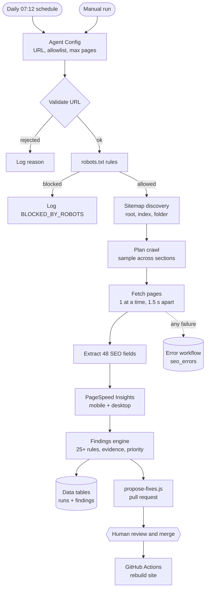

# SEO Growth Agent (n8n)

[](https://github.com/sakter2618-maker/n8n-seo-growth-agent/actions/workflows/tests.yml)

A reusable n8n workflow that audits the SEO of any website you are authorized to
check. It runs on a self-hosted n8n server (Hostinger VPS) and produces evidence-based,
prioritized findings.

Every number in a report comes from the site's own HTML, its robots.txt and sitemap,
or Google PageSpeed Insights. When a step cannot get real data (for example a page
blocks the crawler or an API is rate-limited), the report says so instead of guessing.

> **Status:** milestones 1–7 and the first M9 cycle work and are tested. The agent runs
> daily on the VPS, saves every run and finding to n8n Data Tables, logs failures through
> an error workflow, and its fixes reached the live demo store through a reviewed pull
> request (score 91 → 98). Google Sheets export, Search Console and AI summaries are next.
> See [Roadmap](#roadmap).

## What it does



(Static image: [docs/img/architecture.png](docs/img/architecture.png))

| Step | What happens | Why it matters |
|---|---|---|
| **Validate** | Checks format, blocks localhost, private IPs, odd ports and URLs with passwords, and enforces an allowlist of authorized domains | The agent can't be turned against your own server or used on sites you don't own |
| **robots.txt** | Parses Allow/Disallow with longest-match rules, `Crawl-delay` and `Sitemap:` lines | Respects site owners. If robots.txt returns a server error, nothing is crawled (the same rule Google uses) |
| **Discover** | Reads the sitemap, follows sitemap indexes (WordPress, WooCommerce, Shopify), and samples pages round-robin across sections | A 20-page audit covers products, categories and blog posts, not just the first 20 URLs |
| **Fetch** | One request at a time with at least 1.5 s between them, retries once, records HTTP errors | Never overloads a site, and one failed page doesn't stop the audit |
| **Extract** | 48 fields per page, parsed from the raw HTML the way a search engine first sees it | Comments and `<script>` content are ignored, so hidden "fake" headings are not counted |
| **PageSpeed** | Lab metrics (score, LCP, TBT, CLS) and real-user Core Web Vitals when Google has them | Performance is a ranking factor and a conversion factor |
| **Findings** | Each finding has a severity, the affected pages, the exact evidence, a fix and a link to Google's documentation | Every recommendation can be checked by a person |

## Example result: live demo store

[Sutokotha](https://sakter2618-maker.github.io/sutokotha/) is a demo store built for this
project, with 6 SEO issues planted on purpose. First live audit, run_47 (2026-10-28):
35 of 35 pages audited (34 found through the sitemap), **all 6 planted issues found**, SEO
health score **91/100**.

| Priority | Finding | Evidence (shortened) |
|---|---|---|
| P2 | Meta description missing | 6 pages, e.g. /products/akash-kantha-throw/ → no tag |
| P2 | No canonical tag | 5 category pages |
| P2 | Images without alt text | 3 product pages, 1 image each |
| P2 | Duplicate title | two "Nodi kantha throw" product pages |
| P2 | No H1 | /journal/caring-for-hand-stitched-cotton/ |
| P3 | Sitemap not in robots.txt | sitemap found in the /sutokotha/ folder |

The fixes were proposed as [pull request #1](https://github.com/sakter2618-maker/sutokotha/pull/1)
and went live only after a person reviewed and merged it. Re-audit (run_48):

| | Before | After |
|---|---|---|
| SEO health score | 91 | **98** |
| Medium findings | 5 | **0** |
| Total findings | 12 | 7 (only editorial items and things outside the repo) |

Full write-up: [Sutokotha docs/RESULTS.md](https://github.com/sakter2618-maker/sutokotha/blob/main/docs/RESULTS.md).

The SEO health score is our own transparent formula, not a Google metric: 100 minus
(High 15 / Medium 7 / Low 2) × share of pages affected, per finding.

## Accuracy safeguards

- **No invented numbers.** If PageSpeed is rate-limited, the run records `RATE_LIMITED` and adds an Info finding. It never estimates a score.
- **JavaScript-rendered pages are not mis-reported.** A page with almost no text and several scripts is flagged as "content may load via JavaScript" and left out of content checks. Without this, the agent would report false "missing title" or "missing H1" findings.
- **Industry guidelines are labelled as guidelines.** For example: "60 characters is an industry guideline, not a Google rule."
- **Cross-checked.** Extraction results were compared with Python's standard HTML parser on 20 live pages, with zero mismatches.

## Run it

1. In n8n, go to **Workflows → Import from file** and choose `workflows/seo-growth-agent.json`.
2. Open **Agent Config** and set:
   - `targetUrl`
   - `allowedDomains` (comma-separated)
   - `maxPages`
3. Optional: for PageSpeed, create a free Google API key and add it in n8n as a **Query Auth** credential with name `key`. Attach it to the **PageSpeed API** node.
4. Click **Execute workflow**. Results are in **Generate Findings**: one item per finding, plus a summary item.

## Tests

Every Code node lives in `src/nodes/` as the exact code that runs in n8n. The tests run
that code with fake inputs, so no n8n server or internet connection is needed.

```bash
node --test
```

The 12 tests cover URL validation and security, robots.txt rules, sitemap index
handling, crawl sampling, extraction from messy HTML, PageSpeed parsing and error
states, and the findings engine. See [docs/TESTING.md](docs/TESTING.md).

## Project layout

```
workflows/                        n8n exports (agent + error handler), import guide
docs/DATA_TABLES.md               storage schema
src/nodes/*.js                    source of each Code node
tests/                            automated tests and fixtures
docs/TESTING.md                   manual and automated test steps
docs/INTERVIEW_GUIDE.md           how to explain the project
```

## Roadmap

| Milestone | Status |
|---|---|
| M1 URL validation and allowlist | ✅ Done |
| M2 robots.txt-aware, throttled crawling | ✅ Done |
| M2.1 Sitemap discovery with section sampling | ✅ Done |
| M3 SEO data extraction | ✅ Done |
| M4 PageSpeed Insights | ✅ Built; needs an API key for live scores |
| M5 Findings and prioritization | ✅ Done |
| M6 Save results (n8n Data Tables: runs, findings) | ✅ Done — Google Sheets mirror next |
| M7 Daily schedule + error workflow logging to `seo_errors` | ✅ Done — email alerts next |
| M8 Search Console, sales data, AI summary | Planned |
| M9 Fix proposals as pull requests, published only after human approval | ✅ First cycle done (PR #1, score 91 → 98); next: open PRs from n8n directly |

The live test site is [Sutokotha](https://github.com/sakter2618-maker/sutokotha), a demo
store built for this project with known SEO issues for the agent to find.
